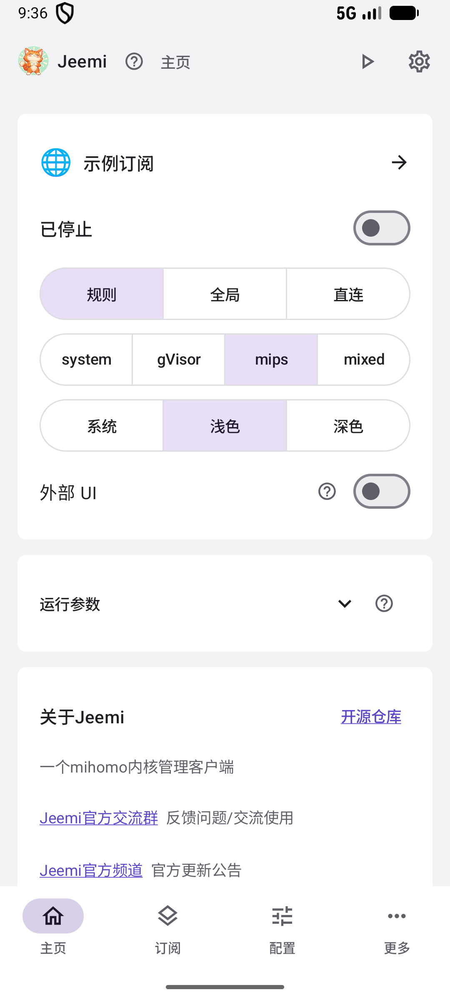
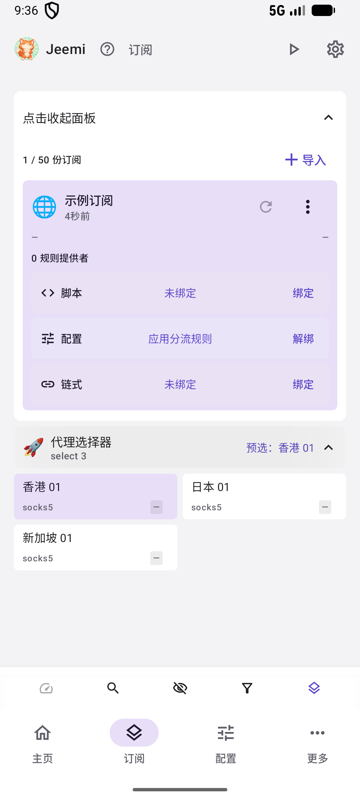
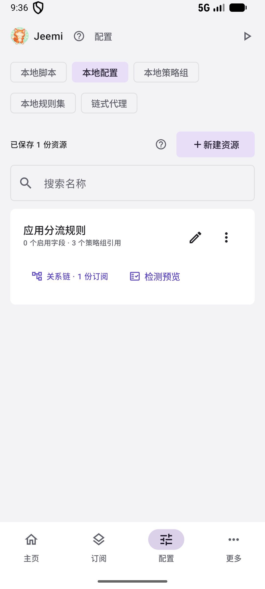
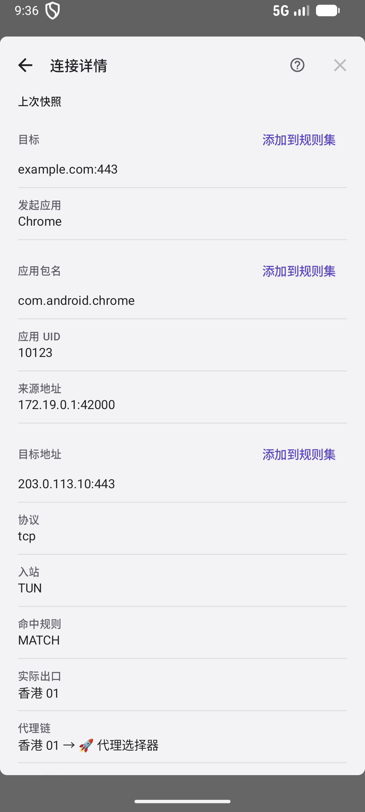
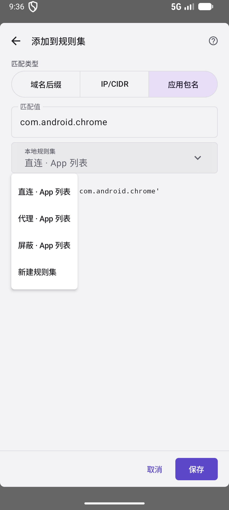
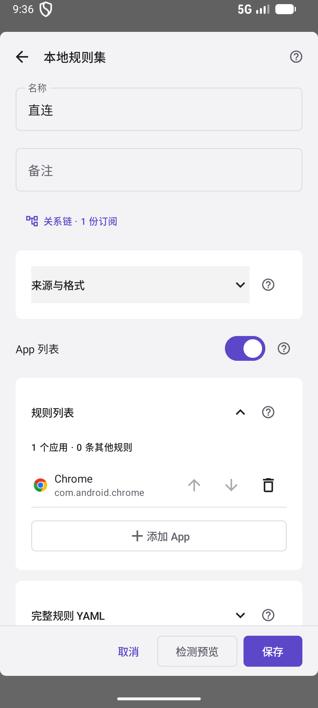
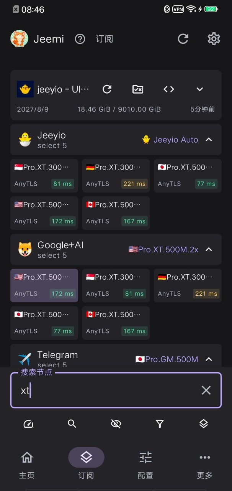

# Jeemi Android

一个基于 mihomo 的开源 Android VPN 客户端，使用 Kotlin、Compose 与 Go，支持 Android 8.0（API 26）及以上的手机和平板。安卓原生界面，耗电低！不同订阅关联不同(相同)本地脚本、规则配置、链式代理关联方式，高灵活度实现自定义订阅配置。

支持规则/远程节点与策略组图片的持久缓存、首页本地 zashboard 面板入口、脚本 URL 导入/刷新，以及嵌套选择器逐层浏览与最终出口节点。运行中保存配置自动应用，系统通道参数变化时自动重建。

## 官方交流与公告

- [Jeemi官方交流群](https://t.me/Jeemi_group)：反馈问题/交流使用。
- [Jeemi官方频道](https://t.me/Jeemi_channel)：官方更新公告。

## 下载

 · [全部版本](https://github.com/bluevava/jeemi-android/releases)

点击下表徽章可直接下载已发布的安装包；大多数 Android 手机和平板请选择 **ARM64**。

<!-- android-downloads:start -->
| 版本 | 适用设备 | APK 下载 | 校验 |
| --- | --- | --- | --- |
| [v0.1.5](https://github.com/bluevava/jeemi-android/releases/tag/v0.1.5) | ARM64 手机 / 平板 |  | [SHA-256](https://github.com/bluevava/jeemi-android/releases/download/v0.1.5/Jeemi-Android-v0.1.5-arm64.apk.sha256) |
| [v0.1.5](https://github.com/bluevava/jeemi-android/releases/tag/v0.1.5) | x86_64 设备 / 模拟器 |  | [SHA-256](https://github.com/bluevava/jeemi-android/releases/download/v0.1.5/Jeemi-Android-v0.1.5-amd64.apk.sha256) |
<!-- android-downloads:end -->

[查看此版本完整校验清单](https://github.com/bluevava/jeemi-android/releases/download/v0.1.5/SHA256SUMS) · [发布元数据](https://github.com/bluevava/jeemi-android/releases/download/v0.1.5/release.json)

没有通用包或 32 位包。正式发布使用同一自签名证书，附每包 SHA-256、`SHA256SUMS` 和包含证书指纹、公开源码提交的 `release.json`。安装时允许所用下载应用安装 APK；VPN 连接另由 Android 系统授权。

## 功能

- 主页控制 VPN 和出站模式，可选 system / gVisor / mips / mixed（默认 mips），支持主题切换、默认收起的运行参数，以及可重新安装的外部 UI。
- 导入订阅链接或文本，管理选择器、节点、测速与预选；支持扫码填入订阅链接。
- 代理运行时订阅拉取失败，自动直连重试一次；失败保留旧订阅，不改变代理状态。
- 策略组支持 `icon` 图片链接，图片优先；加载中或失败时回退名称开头的 Emoji，没有 Emoji 则显示默认图标。
- 本地配置、脚本、策略组、规则集与链式代理组合；保存失败保留原状态。
- 连接列表和详情、日志、DNS 查询；应用规则使用 Android 包名。
- 简体中文和英文、浅色和深色主题，手机和平板均采用竖屏单列布局。

内置 `v1.19.33-jeemi.1` 核心基于官方 mihomo v1.19.33，保留 Android VpnService FD、应用归属桥接与出站套接字保护；两种架构携带相同的 2026-11-11 GEO 快照。核心来源、补丁、归档、哈希和上游许可证保留在 `resources/`。

订阅自动更新仅在 Jeemi 界面前台可见时检查；退到后台或划掉界面后暂停下载及节点列表轮询，已运行的代理继续工作，返回界面再补一次到期更新。

当前设备验证主要来自 Android 16 x86_64 模拟器；ARM64 真机、API 26、16 KB 页设备和厂商后台策略仍需覆盖。曾观察到模拟器 ART 原生崩溃，Compose 固定版本不代表该问题已解决。功能说明对应当前源码，已发布安装包的变更以相应 Release 为准。

## 界面预览（v0.1.5 开发版）

以下为 **v0.1.5 开发版**的实际界面，图片使用演示订阅与连接数据。

  
  
  

## 从连接详情快速添加 App 分流

内置的 **应用分流规则**提供 **🚀 代理选择器**和三份空规则集：**直连 / 代理 / 屏蔽**。绑定订阅后，无须手写 YAML，即可逐步添加自己的 App 分流。

1. 在订阅卡的 **配置** 行绑定 **应用分流规则**。
2. 主页选择 **规则**；在 **运行参数 → 基础设置**中把进程匹配设为 **始终匹配**，保存后启动或重启代理。
3. 打开目标 App 产生连接，在 **更多 → 连接 → 连接详情**中，点击**应用包名**旁的 **添加到规则集**。
4. 选择 **直连 / 代理 / 屏蔽**，核对预览并保存；**重启代理后生效**。

  
  
  

**[查看完整图文教程 →](docs/app-routing.md)** · [English guide](docs/app-routing.en.md)

改变 App 去向时，还要移除旧集合中的规则；添加不会自动迁移，重复规则按顺序首次匹配。主页局域网绕过仍优先。

查看 v0.1.4 订阅界面

## 致谢

- [Wails](https://github.com/wailsapp/wails)：应用框架。
- [Mihomo](https://github.com/MetaCubeX/mihomo)：代理核心。
- [jeemi-desktop](https://github.com/bluevava/jeemi-desktop)：参考项目。
- [Jeeyio](https://t.me/jeeyio_channel)：赞助支持。

构建、签名和发布方法见 [BUILDING.md](BUILDING.md)，版本说明见 [CHANGELOG.md](CHANGELOG.md)。许可证见 [LICENSE](LICENSE)。
