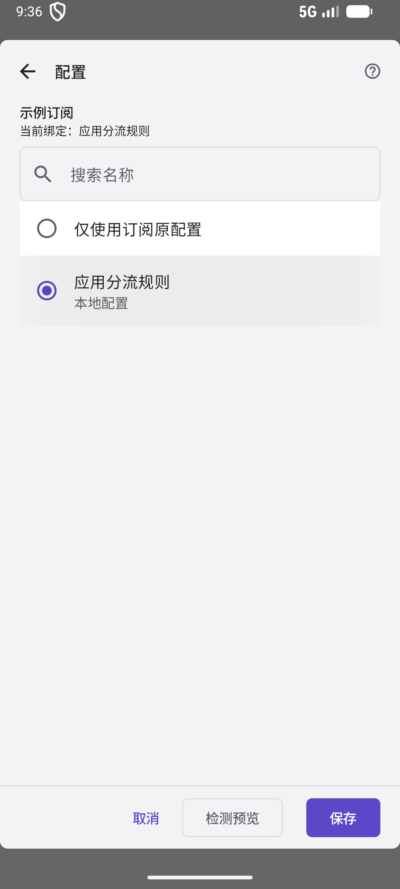
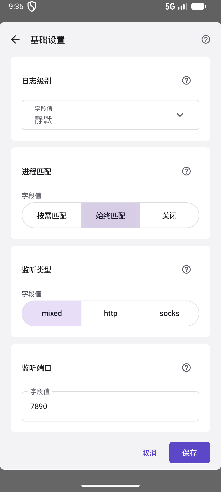
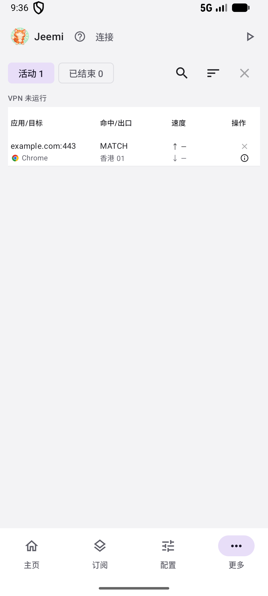
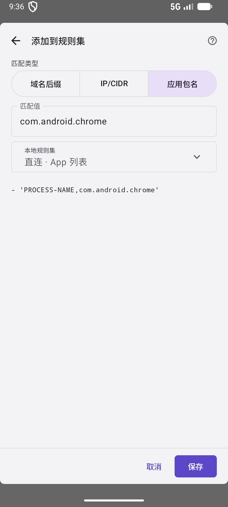

# Route apps with the built-in configuration

[Home](../README.md) · [简体中文](app-routing.md)

**Preview of the v0.1.5 development build.** This built-in setup is not available in v0.1.4. After release, use v0.1.5 or later. Screenshots show the actual Android UI in Chinese, with synthetic subscriptions, nodes and connection records. They are not working proxy endpoints or benchmark results.

Import your subscription, bind **App routing rules**, then add an app from its connection details to **Direct / Proxy / Block**. No YAML editing or manual group setup is needed.

## 1. Bind App routing rules to your subscription

Open **Subscriptions**, expand the subscription panel, and choose **Bind** on the card's **Config** row. Select **App routing rules** and **Save**. The card will display the bound configuration.

  
  

The preset uses a complete rebuild of rules and groups while retaining subscription nodes and proxy providers. It includes **🚀 Proxy selector** and three initially empty rule sets. Unmatched traffic reaches the selector; the home LAN bypass rules still take priority.

A local configuration and a local script are mutually exclusive. Binding the preset replaces a script binding on that card. Keep the subscription's catch-all override set to **Follow configuration** to retain the preset's default target.

## 2. Enable Rule mode and app identification

On **Home**, select **Rule**. Expand **Runtime preferences → Basic settings**, set **Process matching** to **Always**, and **Save**.

  
  

When the rule sets are empty, the default on-demand process lookup may not query app packages. Always mode helps populate package names, but Android can still withhold app identity for some connections.

Choose a node in **🚀 Proxy selector**, start the proxy, and accept Android's VPN permission request. If it is already running, use the top-bar restart button to apply the saved settings.

## 3. Find a connection from the app

Open the app you want to route, load or refresh some content, then return to **More → Connections**. Tap its row or details icon.

  
  

For app-wide routing, choose **Add to rule set** beside **Application package**, such as `com.android.chrome`. The target and destination-address actions instead create domain or IP rules.

The screenshots use an offline demonstration record, so the list shows an offline status. Start the proxy in normal use. Connections are observed only while this page is visible in the foreground; short connections and background history may be missed. Generate another request if needed.

## 4. Choose Direct, Proxy or Block

Check the package name in **Add to rule set**, then select an existing **Local rule sets**.

| Rule set | Result after saving and restarting |
| --- | --- |
| **Direct** | Matching app connections use `DIRECT` |
| **Proxy** | Matching app connections use **🚀 Proxy selector** |
| **Block** | Matching app connections use `REJECT` |

  
  

This example adds Chrome to **Direct**. Jeemi previews `PROCESS-NAME,com.android.chrome`; confirm the package and destination set, then **Save**.

Use one of these already-linked sets. A newly created set must also be referenced by a strategy group before it takes effect. The package action prioritizes sets with App list enabled, but its default selection does not infer your desired route.

## 5. Check the App list and restart

Open **Config → Local rule sets → Direct**. With **App list** enabled by default, installed apps show an icon, name and package. Reorder or remove entries, or use **Add app** to add more installed apps.

Use the top-bar **Restart** button to apply the saved rules, or start the proxy if stopped. Make a new request in the app and check its matched rule and actual outbound in Connections. Saving does not update the active session immediately.

## Remove the old rule when changing an app's route

Adding a rule appends it; it does not remove the app from other sets. To move Chrome from Direct to Block, remove its old Direct entry, add it to Block, save, and restart.

The preset order is **home LAN bypass → Block → Direct → Proxy → MATCH (Proxy selector)**. The first matching rule wins. Global and Direct modes do not evaluate this routing plan rule by rule.

If no package is available, use a domain/IP rule or select the installed app via **Add app** in the rule-set editor. Built-in resources are editable and removable. They are initialized once and are not recreated on every startup after deletion.
